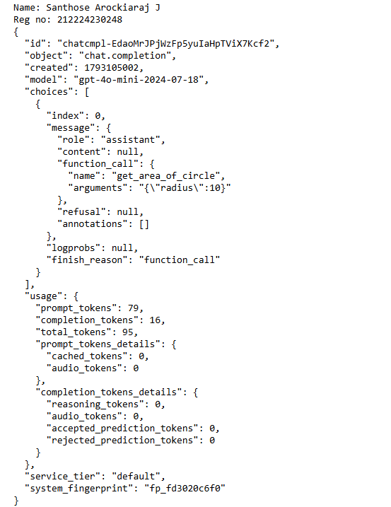
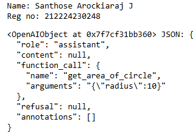
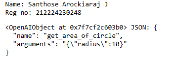
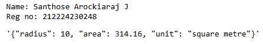

## Integration of a Mathematical Calulations with a Chat Completion System using LLM Function-Calling

### AIM:
To design and implement a Python function for calculating the area of circle, integrate it with a chat completion system utilizing the function-calling feature of a large language model (LLM).

### PROBLEM STATEMENT:
Develop a Python application that uses the Function Calling capability of an LLM to identify a user's request for a currency exchange rate. The LLM should automatically invoke a predefined Python function that returns the exchange rate of the requested currency in JSON format. This demonstrates how LLMs can interact with external functions to provide structured and reliable information.

### DESIGN STEPS:

#### STEP 1:
Import the required Python libraries (openai, json, os, and dotenv) and configure the OpenAI API key.

#### STEP 2:
Create a Python function get_exchange_rate(currency) that stores sample exchange rates in a dictionary and returns the corresponding exchange rate in JSON format.

#### STEP 3:
Define the function schema, send the user's query to the Chat Completion API, allow the LLM to invoke the appropriate function, parse the function arguments, execute the Python function, and display the JSON response.

### PROGRAM:
```python
Name: Santhose Arockiaraj J
Reg no: 212224230248
```
#### Import libraries and initialize the API
```python
import os
import openai
import math

from dotenv import load_dotenv, find_dotenv
_ = load_dotenv(find_dotenv()) # read local .env file
openai.api_key = os.environ['OPENAI_API_KEY']
```
#### Define the circle-area function
```python
import json

def get_area_of_circle(radius, unit="square metre"):
    area =math.pi * radius ** 2
    area_info={
        "radius":radius,
        "area": round(area,2),
        "unit":unit
    }
    return json.dumps(area_info)
    
```
#### Define the function schema
```python
# define a function
functions=[
    {
        "name": "get_area_of_circle",
        "description": "Calculate the area of a circle using its radius.",
        "parameters": {
            "type": "object",
            "properties": {
                "radius": {
                    "type": "number",
                    "description": "The radius of the circle in metres."           },
                "unit": {"type": "string", "enum": ["square metre"]},
            },
            "required":["radius"]
        },
    }
]

```
#### Define the user message

```python
messages= [
    {
        "role": "user",
        "content": "What's the area of circle if the radius of the circle is 10?"
    }
]
```
#### Call the OpenAI API
```python
# Call the ChatCompletion endpoint
response = openai.ChatCompletion.create(
    model="gpt-4o-mini",
    messages=messages,
    functions=functions,
   
)
```
#### Display the response
```python
print("Name: Santhose Arockiaraj J\nReg no: 212224230248")
print(response)
```
#### Extract the assistant message
```python
response_message = response["choices"][0]["message"]
```
#### Display the assistant message
```python
print("Name: Santhose Arockiaraj J\nReg no: 212224230248")
response_message
```
#### Check the assistant's text content
```python
response_message["content"]
```
#### Display the function call
```python
response_message["function_call"]
```
#### Convert the arguments from JSON
```python
json.loads(response_message["function_call"]["arguments"])
```
#### Store the parsed arguments
```python
args = json.loads(response_message["function_call"]["arguments"])
```
#### Execute the function
```python
print("Name: Santhose Arockiaraj J\nReg no: 212224230248")
get_area_of_circle(**args)
```

### OUTPUT:
#### OpenAI API Response



#### Assistant Message with Function Call



#### Extracted Function Call Details



#### Function Response (JSON Output)



### RESULT:

The get area of circle function was successfully integrated with the Chat Completion System using the Function Calling feature of an LLM. The model correctly identified the required function, passed the appropriate parameter, executed the Python function, and returned the exchange rate as a structured JSON response.
